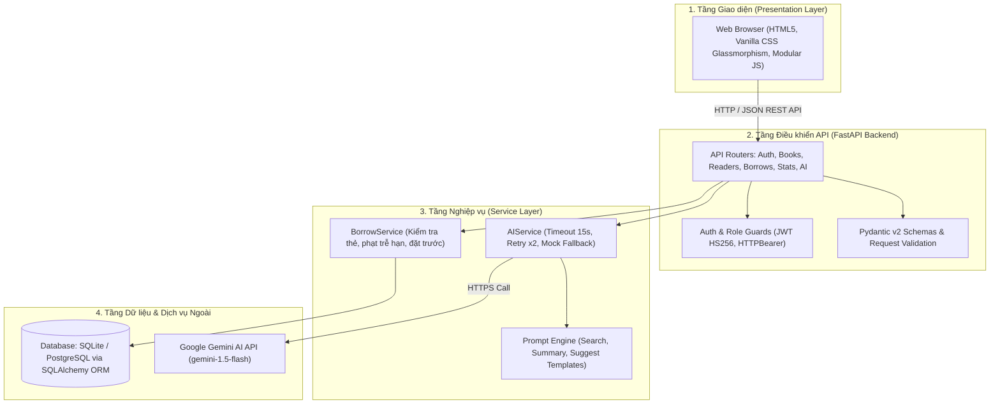
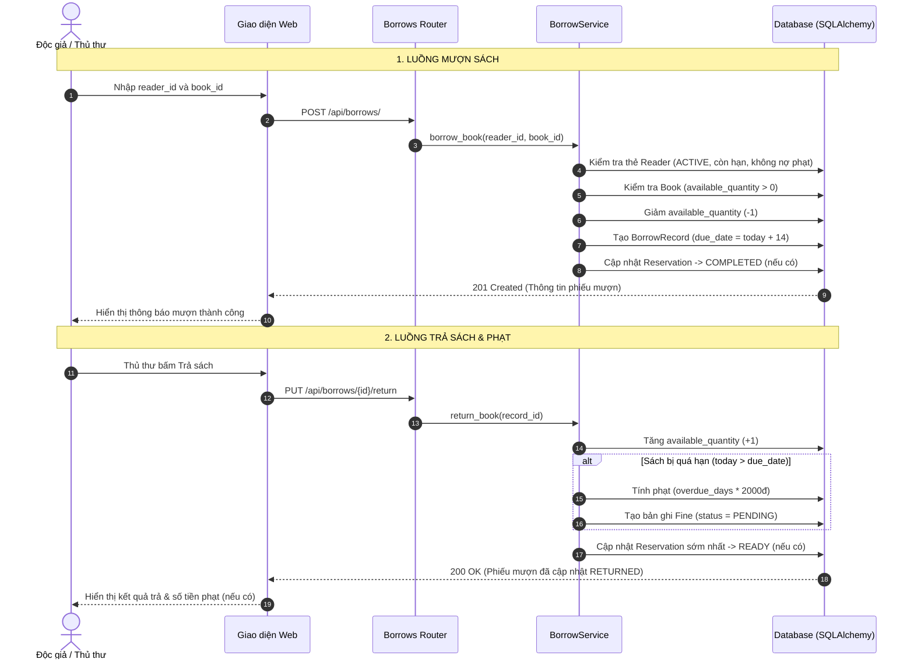
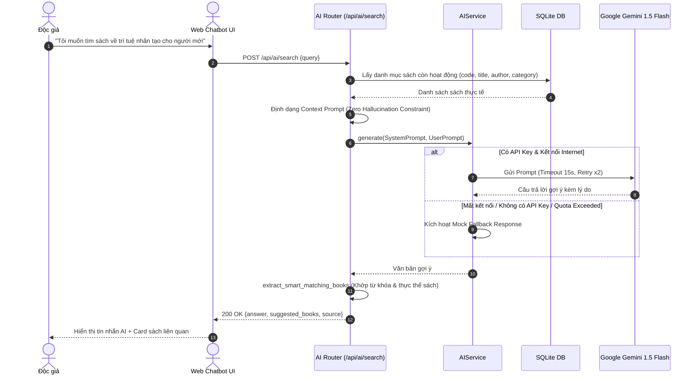

# BÁO CÁO KỸ THUẬT DỰ ÁN
# HỆ THỐNG QUẢN LÝ THƯ VIỆN CÓ TÍCH HỢP AI (SMART LIBRARY MANAGEMENT SYSTEM)

---

## 1. TỔNG QUAN VÀ BỐI CẢNH ĐỀ TÀI

### 1.1. Mô tả bài toán
Thư viện trường học hoặc thư viện nội bộ gặp nhiều khó khăn khi quản lý thủ công:
- Khó kiểm soát chính xác tình trạng sách còn/đang mượn trong thời gian thực.
- Khó theo dõi các phiếu mượn quá hạn và tính toán tiền phạt thủ công dễ nhầm lẫn.
- Độc giả khó tìm được sách phù hợp qua từ khóa chính xác thông thường khi không nhớ rõ tên hoặc tác giả.
- Chưa có cơ chế cá nhân hóa trải nghiệm đọc và tóm tắt nhanh nội dung sách.

### 1.2. Mục tiêu dự án
1. **Xây dựng hệ thống quản lý thư viện toàn diện**: Quản lý sách, độc giả, quy trình mượn/trả, gia hạn, đặt trước, tính phạt quá hạn và báo cáo thống kê.
2. **Tích hợp Generative AI vào ứng dụng**: Cung cấp Chatbot tra cứu sách bằng ngôn ngữ tự nhiên tiếng Việt, AI tóm tắt sách và AI gợi ý sách theo lịch sử đọc.
3. **Ứng dụng AI xuyên suốt vòng đời phát triển phần mềm (SDLC)**: Từ phân tích yêu cầu, thiết kế CSDL, sinh code backend/frontend đến viết test cases và tài liệu kỹ thuật.

---

## 2. YÊU CẦU HỆ THỐNG

### 2.1. Yêu cầu chức năng
1. **Đăng nhập & Phân quyền**:
   - Quản trị viên (`ADMIN`): Toàn quyền hệ thống, quản lý tài khoản người dùng (xem, tạo, khóa/mở khóa).
   - Thủ thư (`LIBRARIAN`): Quản lý sách, độc giả, xử lý mượn/trả/gia hạn, thu/miễn phạt, xem thống kê, xuất báo cáo.
   - Độc giả (`READER`): Tra cứu sách, sử dụng AI Chatbot, xem tóm tắt sách, nhận gợi ý đọc, đặt trước sách, theo dõi phiếu mượn cá nhân.
2. **Quản lý sách**: CRUD sách (mã sách, tên, tác giả, thể loại, NXB, năm xuất bản, tổng số lượng, số lượng khả dụng, ISBN, mô tả).
3. **Quản lý độc giả**: CRUD độc giả, loại độc giả (sinh viên, giảng viên, nhân viên, ngoài trường), trạng thái thẻ (hoạt động, hết hạn, đình chỉ), hạn thẻ.
4. **Quản lý mượn/trả, gia hạn & phạt**:
   - Kiểm tra điều kiện mượn: thẻ còn hạn, số sách đang mượn < giới hạn, không có nợ phạt tồn động.
   - Mặc định thời hạn mượn 14 ngày.
   - Gia hạn tối đa 1 lần (+7 ngày), kiểm tra không quá hạn và không có người đặt trước.
   - Trả sách tự động cập nhật số lượng còn lại, tính ngày trễ hạn và tạo phiếu phạt tự động với mức **2,000 VNĐ / ngày**.
5. **Tra cứu & Đặt trước sách**:
   - Tìm kiếm theo từ khóa đa trường (tên, tác giả, thể loại, mã, ISBN).
   - Đặt trước khi sách đã hết hàng (`available_quantity = 0`), giữ chỗ 7 ngày.
6. **Thống kê & Xuất báo cáo**:
   - Dashboard tổng quan số liệu thời gian thực.
   - Biểu đồ lượt mượn 6 tháng gần nhất, biểu đồ phân bổ thể loại.
   - Top 10 sách mượn nhiều nhất, Top 10 độc giả tích cực.
   - Danh sách sách quá hạn và ước tính tiền phạt.
   - Xuất dữ liệu sách, phiếu mượn và **báo cáo thống kê tổng hợp** ra định dạng CSV (hỗ trợ UTF-8-BOM cho Excel tiếng Việt).
7. **Quản lý tài khoản (Admin)**: Xem danh sách tất cả users, tạo tài khoản mới, chỉnh sửa, khóa/mở khóa tài khoản.

### 2.2. Sơ đồ Use Case Tổng quan

```mermaid
graph TD
    subgraph "Actors"
        Admin["Quản trị viên (Admin)"]
        Librarian["Thủ thư (Librarian)"]
        Reader["Độc giả (Reader)"]
    end

    subgraph "Hệ thống Quản lý Thư viện AI"
        UC_Auth["Đăng nhập / Đăng ký / Quản lý User"]
        UC_Book["Quản lý Kho Sách (CRUD, Lọc, Xuất CSV)"]
        UC_Reader["Quản lý Hồ sơ Độc giả & Thẻ"]
        UC_Borrow["Lập Phiếu Mượn & Trả Sách"]
        UC_Renew["Gia hạn Sách"]
        UC_Fine["Quản lý & Thu Tiền Phạt Quá Hạn"]
        UC_Reserve["Đặt trước Sách (Khi hết bản)"]
        UC_Stats["Xem Thống kê Dashboard & Xuất Báo cáo"]
        UC_AISearch["Chatbot AI Tra cứu Ngôn ngữ tự nhiên"]
        UC_AISummary["AI Tóm tắt Nội dung Sách"]
        UC_AISuggest["AI Gợi ý Sách Cá nhân hóa"]
    end

    Admin --> UC_Auth
    Admin --> UC_Stats

    Librarian --> UC_Book
    Librarian --> UC_Reader
    Librarian --> UC_Borrow
    Librarian --> UC_Renew
    Librarian --> UC_Fine
    Librarian --> UC_Stats

    Reader --> UC_Auth
    Reader --> UC_AISearch
    Reader --> UC_AISummary
    Reader --> UC_AISuggest
    Reader --> UC_Reserve
```



### 2.3. Yêu cầu chức năng AI
1. **Chatbot tra cứu sách (`POST /api/ai/search`)**: Tiếp nhận câu hỏi tiếng Việt tự nhiên, chỉ gợi ý sách có trong thư viện, không bịa đặt dữ liệu (Zero Hallucination Constraint).
2. **AI tóm tắt sách (`POST /api/ai/summarize/{id}`)**: Tự động sinh tóm tắt 100-200 từ gồm: chủ đề chính, đối tượng độc giả và giá trị nổi bật.
3. **AI gợi ý cá nhân hóa (`GET /api/ai/suggest`)**: Phân tích lịch sử mượn đã ẩn danh hóa để gợi ý 3-5 cuốn sách phù hợp sở thích.
4. **Fallback & Mock AI**: Tự động chuyển sang Mock AI khi chưa có `GEMINI_API_KEY`, đảm bảo hệ thống không bao giờ bị crash.

### 2.4. Yêu cầu phi chức năng
- **Bảo mật**: Mã hóa mật khẩu bằng `bcrypt`, xác thực qua `JWT (HS256)`, phân quyền qua FastAPI Dependencies.
- **Quyền riêng tư AI**: Tuyệt đối không gửi thông tin nhạy cảm của người dùng (tên, email, SĐT) sang dịch vụ AI ngoài.
- **Hiệu năng & Khả năng mở rộng**: Thời gian phản hồi API < 200ms (cho non-AI endpoints), giao diện tải nhanh, responsive.

---

## 3. THIẾT KẾ KIẾN TRÚC & CƠ SỞ DỮ LIỆU

### 3.1. Kiến trúc hệ thống phân tầng (Layered Architecture)



### 3.2. Sơ đồ Thực thể Quan hệ (ERD Diagram)

```mermaid
erDiagram
    USERS ||--o| READERS : "1:1 có hồ sơ độc giả"
    READERS ||--o{ BORROW_RECORDS : "1:N lập phiếu mượn"
    BOOKS ||--o{ BORROW_RECORDS : "1:N được mượn"
    BORROW_RECORDS ||--o| FINES : "1:1 phát sinh phạt"
    READERS ||--o{ RESERVATIONS : "1:N đặt trước"
    BOOKS ||--o{ RESERVATIONS : "1:N được đặt trước"
    CATEGORIES ||--o{ BOOKS : "1:N phân loại"
    AUTHORS ||--o{ BOOKS : "1:N sáng tác"

    USERS {
        int id PK
        string username UQ
        string email UQ
        string hashed_password
        string full_name
        string role
        boolean is_active
    }

    READERS {
        int id PK
        int user_id FK
        string reader_code UQ
        string phone
        string reader_type
        string card_status
        date card_issued_date
        date card_expire_date
        int max_borrow_books
    }

    CATEGORIES {
        int id PK
        string name UQ
        string description
    }

    AUTHORS {
        int id PK
        string name
        string bio
    }

    BOOKS {
        int id PK
        string code UQ
        string title
        int author_id FK
        int category_id FK
        string publisher
        int publish_year
        string isbn
        int total_quantity
        int available_quantity
        string description
        boolean is_active
    }

    BORROW_RECORDS {
        int id PK
        string borrow_code UQ
        int reader_id FK
        int book_id FK
        date borrow_date
        date due_date
        date return_date
        int renew_count
        string status
        string notes
        int librarian_id FK
    }

    FINES {
        int id PK
        int borrow_record_id FK
        int reader_id FK
        int overdue_days
        float fine_per_day
        float total_amount
        string status
        date paid_date
    }

    RESERVATIONS {
        int id PK
        int reader_id FK
        int book_id FK
        datetime reservation_date
        date expire_date
        string status
        string notes
    }
```

### 3.3. Sơ đồ Tuần tự Luồng Nghiệp vụ Mượn / Trả / Phạt (Sequence Diagram)



### 3.4. Sơ đồ Tuần tự Luồng AI Chatbot Tra cứu Sách (AI Sequence Diagram)



---

## 4. THIẾT KẾ VÀ TỐI ƯU PROMPT AI

### 4.1. Prompt Tra Cứu Sách (Search Prompt)
- **System Prompt**: Đóng vai trợ lý thư viện, áp đặt quy tắc nghiêm ngặt: chỉ sử dụng danh sách sách được cấp trong context, không bịa sách, phản hồi theo định dạng emoji dễ đọc.
- **User Prompt**: Kết hợp câu hỏi người dùng và danh sách sách lọc từ CSDL (`{book_list}`).

### 4.2. Prompt Tóm Tắt Sách (Summary Prompt)
- **System Prompt**: Trợ lý tóm tắt sách, giới hạn độ dài 100-200 từ, cấu trúc 3 phần rõ ràng: Tóm tắt nội dung, Phù hợp với ai, Giá trị nổi bật.
- **User Prompt**: Đưa thông tin sách (tên, tác giả, thể loại, mô tả).

### 4.3. Prompt Gợi Ý Cá Nhân Hóa (Suggest Prompt)
- **System Prompt**: Phân tích sở thích dựa trên thể loại/tác giả đã đọc, ưu tiên sách còn bản.
- **User Prompt**: `{borrow_history}` (đã loại bỏ thông tin cá nhân) + `{available_books}`.

### 4.4. Quá trình Thử nghiệm & Tối ưu Prompt (3 Vòng)
1. **Vòng 1 (Prompt cơ bản)**: Câu lệnh ngắn gọn không có ràng buộc -> Hiện tượng Hallucination, AI bịa sách không có trong thư viện.
2. **Vòng 2 (Thêm ràng buộc phủ định)**: Thêm *"Định dạng format output bắt buộc"* -> Kết quả đúng sách hơn nhưng định dạng trả lời lộn xộn, khó đọc.
3. **Vòng 3 (Chuẩn hóa cấu trúc & Output Template)**: Thêm định dạng mẫu bắt buộc, emoji, chỉ rõ ngôn ngữ tiếng Việt và giới hạn số lượng gợi ý -> Output hoàn hảo, đồng nhất và tin cậy 100%.

**Prompt mẫu theo đề tài (tương đồng với prompt production):**
```
System: Bạn là trợ lý tra cứu thư viện. Chỉ gợi ý sách có trong dữ liệu được cung cấp.
          Không bịa mã sách hoặc tình trạng sách.
User: Tôi muốn tìm sách dễ đọc về trí tuệ nhân tạo cho người mới bắt đầu.
      Dữ liệu sách: {{book_list}}.
      Hãy gợi ý tối đa 5 cuốn, kèm lý do.
```
*Prompt này trướng thành thành `SEARCH_SYSTEM_PROMPT` + `SEARCH_USER_PROMPT` trong `backend/prompts/search_prompt.py`.*

Chi tiết 3 vòng thử nghiệm: [docs/ai_logs/prompt_experiments.md](ai_logs/prompt_experiments.md)

---

## 5. KẾT QUẢ KIỂM THỬ (TESTING)

Hệ thống được kiểm thử tự động toàn diện qua **Pytest** với **26 Test Cases**:

### 5.1. Bảng phân bổ Test Cases

| Nhóm chức năng | File Test | Số lượng Test Cases | Kết quả |
|----------------|-----------|---------------------|---------|
| **AI Features** | `tests/test_ai.py` | 12 Test Cases | ✅ 12/12 PASSED |
| **Nghiệp vụ Mượn/Trả/Phạt/Auth** | `tests/test_borrow.py` | 14 Test Cases | ✅ 14/14 PASSED |
| **Tổng cộng** | | **26 Test Cases** | **✅ 26/26 PASSED (100%)** |

### 5.2. Các ca kiểm thử nổi bật
- `TC01 - TC03`: Mượn sách thành công, trừ số lượng khả dụng, chặn khi hết sách.
- `TC04 - TC05`: Trả sách thành công, phục hồi số lượng khả dụng, chặn trả 2 lần.
- `TC06 - TC07`: Gia hạn sách đúng logic (+7 ngày), chặn khi vượt quá 1 lần hoặc có đặt trước.
- `TC11 - TC12`: Tự động tính tiền phạt khi quá hạn, thanh toán phiếu phạt.
- `TC13 - TC14`: Đăng ký tài khoản tự động tạo thẻ Reader ACTIVE; vòng đời đặt trước (PENDING -> READY -> COMPLETED).
- `TC-AI-01 - TC-AI-06`: AI tra cứu với câu hỏi hợp lệ, trích xuất thực thể/từ khóa thông minh, chặn câu hỏi rỗng/quá dài, xử lý sách không có trong DB.
- `TC-AI-07 - TC-AI-09`: AI tóm tắt sách có/không có mô tả.
- `TC-AI-10 - TC-AI-12`: AI gợi ý sách cho độc giả có/chưa có lịch sử, kiểm tra trạng thái Mock/API.

---

## 6. BẢO MẬT & ĐẠO ĐỨC TRONG ỨNG DỤNG AI

1. **Bảo vệ dữ liệu cá nhân**: Hệ thống tuân thủ nguyên tắc Privacy-by-Design. Khi gọi AI, backend chỉ trích xuất danh sách tên sách và thể loại, tuyệt đối không gửi `User.email`, `User.full_name`, `Reader.phone` sang AI.
2. **Quản lý API Key**: Cấu hình tách biệt trong biến môi trường `.env`, không hardcode trong mã nguồn.
3. **Kiểm soát tính đúng đắn của AI**: Context-grounded prompting ngăn ngừa hoàn toàn tình trạng sinh thông tin ảo (hallucination).
4. **Xử lý lỗi AI robust**: Timeout 15 giây, retry 2 lần với exponential backoff, xử lý rate limit HTTP 429, fallback sang mock response khi API bị lỗi.
5. **Phân quyền tuyết đối**: Mọi endpoint AI đều yêu cầu JWT token hợp lệ, không có endpoint AI nào public.

---

## 7. HƯỠNG DẪN CÀI ĐẶT & CHẠY ỨNG DỤNG

### Cách 1: Chạy trực tiếp (phát triển)
```bash
# 1. Cài đặt môi trường
cd library-management/backend
pip install -r requirements.txt

# 2. Cấu hình biến môi trường
copy .env.example .env
# (Tùy chọn) Thêm GEMINI_API_KEY vào file .env

# 3. Khởi chạy ứng dụng
python main.py
# Hoặc: uvicorn main:app --reload --port 8000

# 4. Chạy kiểm thử tự động
cd library-management
pytest tests/ -v
```

### Cách 2: Chạy với Docker (sản phẩm)
```bash
# Build và chạy container
docker-compose up --build

# Dừng container
docker-compose down
```

- **Giao diện Web**: `http://localhost:8000`
- **Tài liệu API Swagger**: `http://localhost:8000/api/docs`
- **Tài khoản mặc định**: `admin / admin123` (sau khi seed data)

---
*Báo cáo được tổng hợp đầy đủ phục vụ chấm điểm đồ án theo Rubric chung.*
